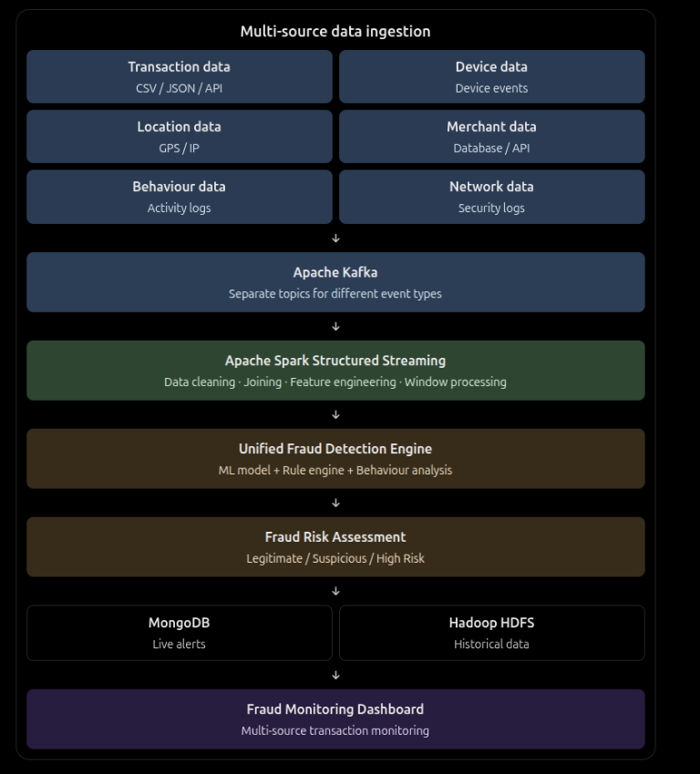

# Real-Time Fraud Detection System

## Architecture

## Overview

This project is designed for real-time fraud detection in financial transactions. It combines multiple data sources, streaming data processing, machine learning, rule-based analysis, and monitoring to identify suspicious behavior and assess transaction risk.

## Key Components

- Multi-source data ingestion from transactions, devices, locations, merchants, behaviour logs, and network security data
- Apache Kafka for event-based message streaming
- Apache Spark Structured Streaming for real-time data cleaning, joining, feature engineering, and window processing
- Unified fraud detection engine combining ML models, rule engines, and behavioural analytics
- Fraud risk assessment for classifying transactions as legitimate, suspicious, or high risk
- MongoDB for live alerts and operational storage
- Hadoop HDFS for historical data retention and analysis
- Fraud monitoring dashboard for centralized visibility

## Summary

The system provides an end-to-end pipeline for detecting fraud in real time while supporting historical analysis and operational monitoring.
